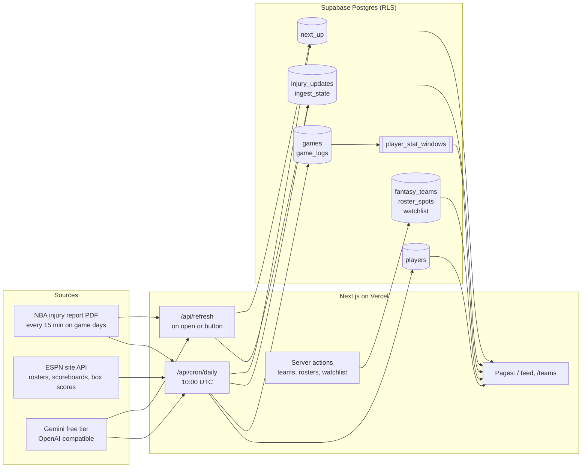
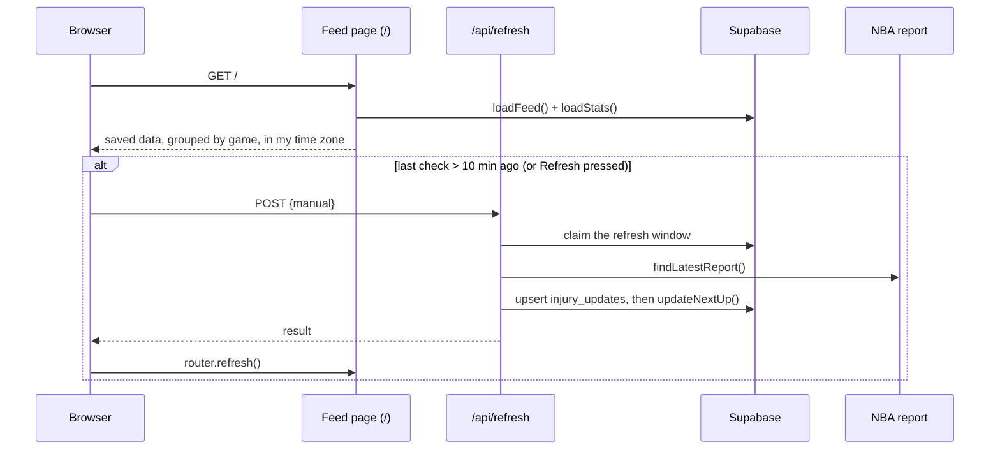

# Fantasy Basketball Assistant

A personal tool that watches NBA injury news and tells me which players stand to gain, starting with the ones on my fantasy teams.

It collapses three chores into one view:
1. **Who is out:** the NBA's official injury report, parsed and grouped by game.
2. **Who is next up:** players likely to gain (or lose) minutes, from a box-score depth chart and a free language model.
3. **How they've been playing:** averages over the last 7, 14 and 30 games next to the season average.

Live app: https://fantasy-basketball-assistant-five.vercel.app (invite-only)<br>
Product requirements, decisions and acceptance results: **[docs/PRD.md](docs/PRD.md)** · Data-source research: [docs/phase-0-findings.md](docs/phase-0-findings.md)

Everything runs on free tiers with no card on file: Vercel Hobby, Supabase Free, ESPN's public site API, the NBA's injury report PDFs and Gemini's free tier.

---

## Contents

- [Architecture](#architecture)
- [Workflows](#workflows)
- [Function reference](#function-reference)
- [HTTP routes](#http-routes)
- [Scripts](#scripts)
- [Database](#database)
- [Setup](#setup)
- [Testing and checks](#testing-and-checks)
- [Project structure](#project-structure)

## Architecture



**Design principles**

- **Every source sits behind its own adapter** in `src/lib/sources/`, so a source that changes or starts charging can be swapped out.
- **Ingest is idempotent:** re-running any job upserts the same rows.
- **The pure logic is unit-tested:** parsing, matching, merging, depth charts, rules and stats are pure functions.
- **The language model only reorders and explains rule candidates.** It can never add a player.
- **Pages never wait on the network:** they render saved data and refresh in the background.

## Workflows

### 1. Opening the feed



1. **`FeedPage`** (`src/app/page.tsx`) reads the time zone cookie (`timeZoneFrom`).
2. It calls **`loadFeed`**, which:
   - loads upcoming `injury_updates`, my teams and the watchlist
   - groups the updates into team-games with `groupsFromUpdates`
   - fetches each group's stored `next_up` answer
   - builds the view with **`buildFeed`**: games ordered by tip-off (`gameStartUtc`), my players pinned, and "your players who gain"
3. **`loadStats`** fetches recent form for my players and every next-up name in one database call.
4. **`RefreshControls`** (client) calls `POST /api/refresh`:
   - automatically, when `isStale` says the last check is over 10 minutes old
   - on demand, when I press **Refresh**
5. Once the refresh finishes, the page reloads its data.

### 2. Injury report ingest: `ingestLatestReport` (`src/lib/injuryIngest.ts`)

1. **Claim the refresh window.** An atomic update on `ingest_state` allows one fetch per 10 minutes (1 minute for a manual refresh). The cron job forces it.
2. **`findLatestReport`** walks back through 15-minute URL slots (`reportUrlFor`) until a report exists. It gives up after 4 hours: no report means no games.
3. If the URL is the one already ingested, it stops with status `unchanged`.
4. **`parseInjuryReport`** reads the PDF with `unpdf`:
   - groups text into rows by position and finds columns from the header
   - carries the date, matchup and team down to the rows that leave them blank
   - stitches wrapped reasons back together
   - records the printed rows as `rawText`
5. It loads the player directory (`indexDirectory`) and ESPN team names, then matches each name with **`matchPlayer`**: same team first, then a unique name league-wide.
6. **`planInjuryUpserts`** merges the report into one row per (player, game):
   - **New rows:** first-seen time and one history item.
   - **Changes:** a new history item and a new `changed_at`.
   - **Repeats:** the report time only.
   - **Older reports:** skipped.
   - **Flags:** `ongoing` (same status as the previous game) and `is_returning` (from out or doubtful to probable or available).
7. Upserts the rows and records the report URL and time in `ingest_state`.

### 3. Next-up inference: `updateNextUp` (`src/lib/nextUp/store.ts`)

1. Loads upcoming updates and builds **groups** with `groupsFromUpdates`:
   - one per (team, game)
   - absent = out or doubtful, excluding G League assignments
   - returning = `is_returning`
   - key = date | team | absent ids | returning ids
2. Skips groups that already have an answer, unless the answer was a rules fallback that can still be retried with the model (fewer than 3 attempts).
3. For each remaining group (`computeGroup`):
   - **Depth chart:** loads the roster and the team's recent box scores (current season once it has 3 games), plus recent minutes elsewhere for new arrivals. **`buildDepthChart`** then marks starters by start rate and orders players by minutes.
   - **Fill-ins:** **`startsWithAndWithout`** counts who started in the games each absent or returning player missed.
   - **Rules:** **`ruleBeneficiaries`** builds candidates with `candidatesForAbsent` and `candidatesForReturner`, and takes the rule answer: one of each type, up to 3 per player.
   - **Model:** **`askModel`** sends **`buildPrompt`** (the depth chart plus each candidate's rule note) to Gemini.
   - **Validation:** **`validateModelCalls`** keeps only listed candidates, fixes invalid types, trims reasons with `oneSentence`, and gives any player the model left uncovered the rule answer.
4. Upserts into `next_up`.
5. **Budget:** at most 8 model calls per run, and the model stops at the first 429 (free tier is about 8–10 calls a minute). Later runs upgrade the rule answers.

### 3b. Updating next-up calls by hand: `redo` (`src/lib/nextUp/redo.ts`)

Calls are made once per (team, game, absent set), so a call made before last night's box score loaded doesn't see that game. The feed's **Update next-up calls** button redoes those calls within a daily Gemini allowance (`NEXT_UP_REDO_DAILY_CALLS`, default 60):

1. **`planRedo`** works out what an update would involve:
   - **Out of date:** a call whose team has a finished game after the box scores it used (`next_up.computed_through`) and before the game it's for.
   - **Cost:** one Gemini call per out-of-date call.
   - **Runs left:** remaining allowance ÷ cost.

   The button shows all three, and is greyed out when nothing is out of date or the allowance can't cover another run.
2. **Start:** `reserve_model_calls` reserves the run's calls atomically (refused if they don't fit today). The out-of-date calls are then flagged `needs_recompute` and the first batch of 8 runs.
3. **Continue:** while the page is open, the button runs the next batch every minute, staying under the free tier's per-minute limit. Flagged calls keep showing their old answer until the model redoes them.

### 4. Daily job: `GET /api/cron/daily` (Vercel Cron, 10:00 UTC)

Each step runs even if an earlier one fails, and the response reports each step's result.

1. **`syncPlayers`:** `fetchPlayerDirectory` loads all 30 ESPN rosters, `planPlayerSync` plans the upserts and inactive marks (refusing a fetch under 350 players), and the plan is written to `players`.
2. **`ingestGameLogs(yesterday)`:** `fetchScoreboard` lists completed games and `fetchBoxScore` loads each one. Rows go to `games` and `game_logs`, tagged with season type and `counts_for_stats` (false for All-Star games and the NBA Cup final).
3. **`ingestLatestReport({ force: true })`**
4. **`updateNextUp(today)`**, after the box scores, so depth charts include last night.

The job also keeps the free Supabase project from pausing.

### 5. Recent stats: `loadStats` (`src/lib/stats.ts`)

1. **`currentSeason`** finds the latest regular season with games stored.
2. Calls the Postgres function **`player_stat_windows(ids, season)`**, 200 players per call. Over games played that count for stats, it returns 7-, 14- and 30-game and season averages, plus make and attempt totals.
3. **`toPlayerStats`** turns rows into windows, with FG% and FT% as total makes over total attempts.
4. **`StatsPanel`** shows a one-line summary that opens into the table. **`trend`** colours windows clearly above or below the season average.
5. Never throws: on error, the panel says stats are unavailable.

### 6. Teams, rosters and the watchlist (`src/app/actions.ts`)

- **`TeamsPage`** calls `loadDashboard` → `assembleDashboard` to get teams, rosters, the watchlist and the directory for autocomplete. For each player it records every team he's on.
- **`PlayerSearch`** filters the directory in the browser with `searchPlayers` (word prefixes, accents ignored). Enter or a click calls `addToTeam` or `addToWatchlist`.
- **`PlayerTable`** removes players with `removeFromTeam` or `removeFromWatchlist` and shows `StatsPanel` rows.
- **`TeamForms`**: `createTeam`, `updateTeam` (name and format) and `deleteTeam`.
- Every server action checks the session (`signedInClient`) before writing. Row-level security enforces ownership again in the database.

### 7. Access and sign-in (invite-only)

- **Admin:** `ADMIN_EMAIL` (falling back to `ALLOWED_EMAIL`), checked by **`isAdmin`** (`src/lib/access.ts`). The admin sees **People** and the update button.
- **Inviting:** on **People** (`/people`, admin only), **`inviteUser`** creates the account with `generateLink({ type: "invite" })` and returns a one-time `token_hash` link to copy and send. No email is sent. For someone who already has access, it returns a fresh sign-in link instead.
- **Signing in:** **`sendMagicLink`** emails a link to existing accounts only (`shouldCreateUser: false`). Unknown addresses get the same "check your inbox" reply. **`/auth/callback`** exchanges a `code` (PKCE) or verifies a `token_hash` (`invite` or `magiclink`), then redirects to `/`.
- **Without email:** **`npm run login-link`** mints and opens a one-time link for the admin. `-- --email friend@x.com` prints one to send instead. Both avoid the built-in email rate limit.
- **Sign-ups stay off in Supabase,** so accounts are only ever created by the admin.
- **What each person has:** their own teams, rosters and watchlist (row-level security), and the shared feed, next-up calls and stats.
- **`updateSession`** (`src/lib/supabase/proxy.ts`, run by `src/proxy.ts`) refreshes the session cookie on every page request and redirects signed-out visitors to `/login`.

### 8. Time zone

- **`TimeZoneControl`** (client) writes the browser's zone to the `tz` cookie, keeps it in sync unless one was picked by hand (`tz_manual`), and offers a selector.
- **`timeZoneFrom`** reads the cookies on the server, so the first render already shows local times. The formatters in `format.ts` (`clock`, `dayLabel`, `when`, `localDate`) take the zone as an argument.

## Function reference

### Data sources: `src/lib/sources/`

| Function | File | What it does |
| --- | --- | --- |
| `fetchWithTimeout`, `fetchJson` | `http.ts` | Fetch with a browser-like User-Agent, a timeout and no caching |
| `mapLimit` | `http.ts` | Runs async work over a list with bounded concurrency |
| `reportUrlFor` | `nbaInjuryReport.ts` | URL of the injury report for the 15-minute Eastern slot containing a time |
| `findLatestReport` | `nbaInjuryReport.ts` | Walks back slot by slot to the newest published report (16 slots max) |
| `fetchReport` | `nbaInjuryReport.ts` | Downloads a report PDF |
| `parseInjuryReport` | `nbaInjuryReport.ts` | PDF → entries, not-submitted teams and warnings, by page layout |
| `fetchTeams`, `fetchRoster`, `fetchPlayerDirectory` | `espn.ts` | ESPN teams and rosters → the player directory (IDs, names, positions, teams) |
| `fetchScoreboard` | `espn.ts` | Games on a date with status, season, season type and competition type |
| `fetchBoxScore` | `espn.ts` | One game's player lines: starter flag, minutes, counting stats, makes and attempts |
| `fetchGameLogsForDate` | `espn.ts` | Every completed game's box score for a date |
| `fetchEspnInjuries` | `espn.ts` | ESPN's injury list (secondary feed; used in Phase 0 checks) |
| `llmConfigFromEnv` | `llm.ts` | Reads `LLM_BASE_URL`, `LLM_API_KEY` and `LLM_MODEL` |
| `chatJson` | `llm.ts` | One OpenAI-compatible chat call that must return a JSON object |

### Core logic: `src/lib/`

| Function | File | What it does |
| --- | --- | --- |
| `nameKey` | `names.ts` | Matching key: accents, punctuation and suffixes removed, lowercased |
| `flipReportName` | `names.ts` | "Lively II, Dereck" → "Dereck Lively II" |
| `easternDate`, `addDays`, `compactDate` | `time.ts` | Eastern calendar dates and date arithmetic |
| `easternToUtc` | `time.ts` | Eastern wall-clock time → instant (handles daylight saving) |
| `parseReportTime` | `time.ts` | "03/15/26 05:00 PM" → instant |
| `gameStartUtc` | `time.ts` | "07:30 (ET)" on a game date → tip-off instant (12 is noon, others PM) |
| `localDate`, `clock`, `dayLabel`, `when`, `ago`, `gameDateLabel` | `format.ts` | Display formatting in a given time zone |
| `timeZoneFrom`, `isValidTimeZone` | `timezone.ts` | Reads and validates the display time zone from cookies |
| `planPlayerSync`, `syncPlayers` | `playerSync.ts` | Directory sync plan (upserts and inactive marks, with a size guard) and its database write |
| `matchPlayer`, `indexDirectory`, `updateKey` | `injuryIngest.ts` | Report name → ESPN ID; the (player, game) key |
| `planInjuryUpserts` | `injuryIngest.ts` | Merges a report into stored updates: history, flags, ordering safety |
| `ingestLatestReport` | `injuryIngest.ts` | Rate-limited fetch, parse, match and upsert of the newest report |
| `ingestGameLogs` | `gameLogIngest.ts` | Stores a date's games and box-score lines |
| `assembleDashboard`, `loadDashboard` | `dashboard.ts` | Teams, rosters, watchlist and directory, with every team each player is on |
| `searchPlayers` | `search.ts` | Autocomplete: word-prefix match, first-name matches first |
| `buildFeed`, `loadFeed`, `isStale` | `feed.ts` | Feed view model: games by tip-off, my players, opportunities, unmatched names |
| `seasonLabel`, `currentSeason`, `toPlayerStats`, `trend`, `loadStats` | `stats.ts` | Stat windows, percentages, trend colouring, never-throwing loader |
| `runSpike` | `spike.ts` | Phase 0 source checks (directory, box scores, report, matching, model) |

### Next-up: `src/lib/nextUp/`

| Function | File | What it does |
| --- | --- | --- |
| `teamGames` | `depth.ts` | A team's distinct games, newest first |
| `buildDepthChart` | `depth.ts` | Starters by start rate, minutes order, new-arrival fallback |
| `startsWithAndWithout` | `depth.ts` | Who started in the games a player missed, and when he played |
| `candidatesForAbsent` | `rules.ts` | Fill-in starter, bench at the position, starters at or next to it |
| `candidatesForReturner` | `rules.ts` | Players who started or played up while he sat |
| `ruleBeneficiaries` | `rules.ts` | Rule answer per group: merged calls, excluded and questionable handling |
| `buildPrompt`, `askModel` | `model.ts` | Model prompt with rule notes; call with one JSON retry |
| `validateModelCalls`, `oneSentence` | `model.ts` | Keeps only valid candidates, falls back to rules, trims reasons |
| `groupsFromUpdates` | `store.ts` | Team-game groups and their keys from injury updates |
| `loadGroups`, `loadAnswers` | `store.ts` | Current team-game groups; their stored answers |
| `updateNextUp` | `store.ts` | Computes new answers, flagged updates and model retries within the model budget |
| `planRedo`, `redoStatus`, `redo` | `redo.ts` | Out-of-date calls, run cost and runs left; start or continue a manual update |

### Server actions and auth helpers

| Function | File | What it does |
| --- | --- | --- |
| `createTeam`, `updateTeam`, `deleteTeam` | `src/app/actions.ts` | Team management (name 1–60 characters; format h2h_9cat or roto) |
| `addToTeam`, `removeFromTeam` | `src/app/actions.ts` | Roster changes (adding the same player twice is ignored) |
| `addToWatchlist`, `removeFromWatchlist` | `src/app/actions.ts` | Watchlist changes |
| `sendMagicLink`, `signOut` | `src/app/actions.ts` | Sign-in links for existing accounts only; sign-out |
| `inviteUser` | `src/app/actions.ts` | Admin: creates an account (or reuses one) and returns a one-time sign-in link |
| `adminEmail`, `isAdmin`, `isEmail` | `src/lib/access.ts` | Who the admin is; email shape check |
| `createClient` | `src/lib/supabase/server.ts` | Supabase client acting as the signed-in user (RLS applies) |
| `createAdminClient` | `src/lib/supabase/admin.ts` | Secret-key client for jobs (bypasses RLS; server only) |
| `updateSession` | `src/lib/supabase/proxy.ts` | Session refresh and sign-in redirect for every page |

### UI components: `src/components/`

| Component | What it shows |
| --- | --- |
| `AppHeader` | Injuries / Teams (/ People for the admin) navigation and sign-out |
| `RefreshControls` | Automatic refresh when stale, plus the Refresh button |
| `NextUpUpdate` | "Update next-up calls" with cost, runs left, greyed-out states and batch progress |
| `UpdateItem`, `StatusBadge`, `OwnerTags` | One injury update with history, report text, next-up calls and ownership |
| `StatsPanel` | Recent form: summary line and window table |
| `PlayerSearch` | Autocomplete add-player box |
| `PlayerTable` | A roster or the watchlist, with remove buttons and stats rows |
| `NewTeamForm`, `NewTeamButton`, `TeamSettings` | Create, rename, change format, delete |
| `TimeZoneControl` | Time zone detection and selector |

## HTTP routes

| Route | Auth | Purpose |
| --- | --- | --- |
| `GET /` | Session | Injury feed (`?date=YYYY-MM-DD` for a past day) |
| `GET /teams` | Session | Teams, rosters and watchlist (`?view=all`, `?view=watchlist` or `?view=<team id>`) |
| `GET /people` | Admin | Who has access; give access and copy one-time sign-in links |
| `GET /login` | None | Sign-in form |
| `GET /auth/callback` | One-time link | Completes sign-in |
| `POST /api/next-up/redo` | Admin | "Update next-up calls": `{"action": "start"}` reserves the run's Gemini calls and runs the first batch; `{"action": "continue"}` runs the next batch a minute later |
| `POST /api/refresh` | Session | Ingests the newest report and updates next-up. Body `{"manual": true}` for the 1-minute window |
| `GET /api/cron/daily` | `Bearer $CRON_SECRET` | Daily job (Vercel Cron sends the header) |
| `GET /api/spike` | `Bearer $SPIKE_SECRET` | Phase 0 source checks from the server |

## Scripts

Run them from the project folder; each reads `.env.local`.

| Command | What it does |
| --- | --- |
| `npm run dev` | Local app at http://localhost:3000 |
| `npm test` | Unit tests (Vitest) |
| `npm run lint` / `npm run build` | ESLint / production build (includes type checks) |
| `npm run spike` | Phase 0 source checks from this machine; add `-- --json` for details |
| `npm run login-link` | Opens a one-time admin sign-in link for localhost; add `-- https://<deployment>` for the live app, or `--email friend@x.com` to print a link to send |
| `npm run sync-players` | Loads or refreshes the player directory now |
| `npm run backfill-logs -- 2025-10-21 2026-06-20` | Loads box scores for a date range (safe to re-run) |
| `npm run backtest-nextup` | Replays 20 past starter absences; add `-- --model` to include Gemini, `--season 2027` for another season |
| `npm run spot-check-stats` | Compares 5 players' season averages with ESPN's official numbers |

## Database

Migrations live in `supabase/migrations/`. Run them in order in the Supabase SQL editor.

| Object | Written by | Contents |
| --- | --- | --- |
| `players` | daily sync | ESPN directory: ID, name, `name_key`, position, team, active |
| `fantasy_teams`, `roster_spots`, `watchlist` | me (server actions) | My teams, rosters and watchlist; owner-only RLS |
| `injury_updates` | refresh, cron | One row per (player, game): status, reason, raw text, history, `ongoing`, `is_returning` |
| `ingest_state` | refresh, cron | Rate-limit window, last report URL and time, last error |
| `games`, `game_logs` | cron, backfill | Box scores with season, season type, competition type, `counts_for_stats` |
| `next_up` | refresh, cron, redo | Answer per (team, game, absent + returning set): calls, source, model attempts, `computed_through`, `needs_recompute` |
| `model_budget`, `reserve_model_calls()` | redo | Gemini calls used per day and purpose; atomic reservation within the daily allowance |
| `player_stat_windows(ids, season)` | function | 7-, 14- and 30-game and season averages over games played that count for stats |

Signed-in users can read the shared tables; only the secret key writes them. Anonymous access is refused everywhere.

## Setup

1. **Install:** Node 20+, then `npm install`.
2. **Supabase:** create a free project and run the migrations in order. Under Authentication → URL Configuration, set the Site URL to your deployment and add `http://localhost:3000/**` and `https://<deployment>/**` as redirect URLs.
3. **Settings:** `cp .env.example .env.local` and fill in:

   | Variable | Where it comes from |
   | --- | --- |
   | `NEXT_PUBLIC_SUPABASE_URL`, `NEXT_PUBLIC_SUPABASE_PUBLISHABLE_KEY` | Supabase → Project Settings → API Keys (public) |
   | `SUPABASE_SECRET_KEY` | Same page, Secret keys (`sb_secret_…`, server only) |
   | `ADMIN_EMAIL` | The admin's address (manages people, spends the manual allowance). `ALLOWED_EMAIL` still works |
   | `CRON_SECRET`, `SPIKE_SECRET` | `openssl rand -hex 32` each |
   | `LLM_BASE_URL`, `LLM_API_KEY`, `LLM_MODEL` | Google AI Studio key, `https://generativelanguage.googleapis.com/v1beta/openai`, e.g. `gemini-3.5-flash-lite` |
   | `NEXT_UP_REDO_DAILY_CALLS` | Optional; Gemini calls a day for manual next-up updates (default 60) |

4. **Load data:**
   - `npm run sync-players`
   - `npm run backfill-logs -- <season start> <yesterday>` (last season too, for backtests)
5. **Deploy:** import the repo in Vercel and add the same variables. Make the two `NEXT_PUBLIC_` ones *Config* and the rest *Secret*. `vercel.json` schedules the daily job.
6. **Sign in and lock down:**
   - Create your own account once: run `npm run login-link -- https://<deployment>`, or temporarily allow sign-ups and use the email link.
   - Turn off **Allow new users to sign up** in Supabase.
   - Invite people from **People**.

## Testing and checks

- **Unit tests (`npm test`, 54):**
  - report parsing against a real PDF (`tests/fixtures/`)
  - name matching, Eastern time and daylight saving, update merging and history
  - feed grouping and time zones
  - player sync, dashboard and search
  - depth charts, rules and model validation
  - stat windows and trends
- **Acceptance checks:** `npm run spike` (sources), `npm run backtest-nextup` (next-up 18/20 against a 70% target) and `npm run spot-check-stats` (5 of 5 match ESPN). Results are recorded in [docs/PRD.md](docs/PRD.md).

## Project structure

```
src/
  app/                  pages, server actions, API routes
    page.tsx            injury feed
    teams/page.tsx      teams, rosters, watchlist
    login/, auth/       sign-in
    api/                refresh, cron/daily, spike
  components/           UI components
  lib/
    sources/            NBA report, ESPN, LLM, HTTP adapters
    nextUp/             depth chart, rules, model, storage
    supabase/           server, admin and proxy clients
    *.ts                ingest, feed, stats, dashboard, time, formatting
  proxy.ts              session refresh and sign-in gate (Next 16 proxy)
scripts/                one-off and acceptance scripts
supabase/migrations/    database schema, in order
tests/                  unit tests and the PDF fixture
docs/                   PRD and Phase 0 findings
```
